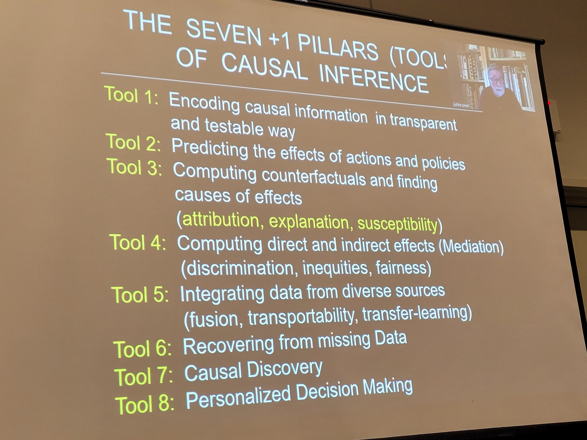
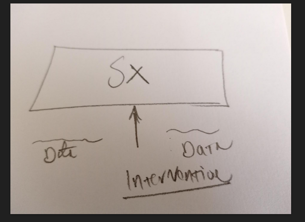
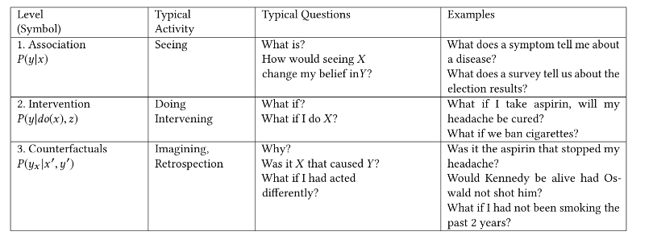

# Causality

> In this note we explore the deep concept of causation and causal models.
> 

> **Causation** refers to the **relationship** between events in which one event **affects** another—specifically, where the occurrence or change of one event brings about a change in another.
> 

> **My Take: Causation is in the mind of the observer; not a fundamental feature of reality.**
> 

> Note: A **Causal Model** is basically a **structural-dynamical model** of something.
> 

> Causality:  Piece of Reality * Technique → Causal Model.
> 

How to think about system interventions?

## Meta

> Evaluation Framework.
> 

### **✅** Evaluation

> What is my **epistemic assessment** of this topic? How well do I understand this subject?
> 

> See more in  & 
> 

| **Meta-Dimension** | **Note** |
| --- | --- |
| **Note Quality** | … |
| **Completeness** | … |
| **Coherence & Structure** | … |
| **Epistemic Self-Assessment** | … |
| **Should I Reorganize This -in My Content Forest?** |  |
| **What’s my study Strategy? Should I Change It?** |  |

### **🌌** Signature

> A comprehensive list of aspects to cover in order to understand a topic.
> 

| Aspect | Causal Modeling |
| --- | --- |
| Nucleus (Deepest Essence) 🧬 | Causal modeling is the formal representation of cause-effect relationships between variables, aiming to understand how interventions or changes in one variable propagate through a system. It’s about inferring mechanisms, not just correlations. |
| Evidentia (Evidence) 📊 | Evidence comes from observational data, experiments, randomized controlled trials, simulations, and sometimes expert knowledge. Verification involves statistical tests, causal inference algorithms (e.g., do-calculus, structural equation modeling), sensitivity analysis, and out-of-sample prediction under interventions. |
| Telos (Intent) 🎯 | Purpose: predict the effect of interventions, inform decisions, and understand mechanisms. Tools: directed acyclic graphs (DAGs), structural equation models, counterfactual frameworks, and causal discovery algorithms. Outcomes: policy guidance, risk assessment, system optimization, and scientific understanding. |
| Gnosis (Understanding) 🧠 | To build mental representation: |
|  | • Understand variables, confounders, mediators, moderators |
|  | • Conceptualize causal diagrams and structural equations |
|  | • Learn to distinguish correlation vs causation |
|  | • Have a foundation in statistics, probability, and logic |
|  | • Develop hierarchical, flexible, connected mental models adaptable to new data and scenarios |
| Epignosis (Application) 🛠️ | Applied in epidemiology, economics, AI interpretability, policy design, medicine, and engineering systems. Advanced skills: counterfactual reasoning, designing interventions, sensitivity analysis, and causal discovery from complex datasets. |
| Relatio (Connections) 🔗 | Interdisciplinary links with statistics, machine learning, systems biology, epidemiology, econometrics, psychology, decision science, philosophy of science, network theory, and dynamical systems. |
| Idoneitas (Suitability) 📐 | Effectiveness measured by predictive accuracy under interventions, consistency with experimental results, robustness to confounders, and ability to identify actionable causal insights. |
| Limites (Limits) ⛔ | Boundaries: |
|  | • Cannot infer causality from correlation alone |
|  | • Limited by unobserved confounders |
|  | • Sensitive to model mis-specification |
|  | • Complexity scales poorly with high-dimensional systems |
|  | • Some systems are too stochastic or emergent for tractable causal modeling |
| Contextus (Context) 🌍 | Emerged from statistics, philosophy of science, and experimental design, formalized by Pearl, Rubin, and others. Historically tied to scientific reasoning, epidemiology, economics, and AI. |
| Dynamis (Evolution) 🌱 | Evolving with machine learning, agent-based modeling, complex systems, and big data analytics. Future directions: automated causal discovery, integration with reinforcement learning, handling highly dynamic or emergent systems. |
| Critica (Critique) 🔍 | Common criticisms: |
|  | • Over-reliance on models with strong assumptions |
|  | • Difficulty with latent variables or feedback loops |
|  | • Risk of misinterpretation in policy decisions |
|  | • Ongoing debates about causality in observational studies vs experiments |
| Verbum Usus (Language Use) 🗣️ | “Causal modeling” is used across scientific, engineering, and policy discourse to denote formal causal inference. Variations: |
|  | • Statistics: DAGs and structural equations |
|  | • AI: causal representation learning |
|  | • Social sciences: causal inference from observational studies |
|  | Usage trends increasingly emphasize algorithmic and computational approaches. |

### 📕 Terminology

> **Afectar (**`afficere`**) :** *hacer algo a alguien o algo*, *ejercer una acción sobre.*
> 

| **Term** | **Description** | **Key Distinction from Causation** |
| --- | --- | --- |
| **Influence** | The capacity to shape or alter outcomes, often indirectly. | May lack direct or necessary connection; often about *tendency* or *pressure*. |
| **Correlation** | A statistical association between variables without implied direction or cause. | No directionality or mechanism; correlation ≠ causation. |
| **Condition** | A circumstance or requirement that must be present for something to occur. | A condition may be necessary, but not sufficient for causation. |
| **Determinant** | A factor that strongly influences an outcome, often statistically identified. | Often used empirically to mean "important cause," but not always in a strict sense. |
| **Factor** | Any element contributing to a result or situation. | Vague about mechanism or necessity; can be causal, enabling, or merely contextual. |
| **Driver** | A dominant force or influence behind a trend or change. | Stronger than “influence”; implies direction and salience. |
| **Mechanism** | The process or system through which an effect is produced. | Describes *how* causation operates, not whether it exists. |
| **Effect** | The outcome or result of a cause. | Defines causation from the result side; implies causality but doesn't establish it alone. |
| **Precondition** | A required state or circumstance that enables a cause to take effect. | Necessary for cause to operate, but not a cause itself. |
| **Trigger** | An event or condition that initiates a process or reaction. | Often an initiating cause, not necessarily the root or structural one. |
| **Antecedent** | Something that comes before an event. | Causally ambiguous; not all antecedents are causes. |
| **Catalyst** | An agent that accelerates or facilitates a process without being the main cause. | Facilitates or accelerates causation but isn’t a primary cause. |
| **Stimulus** | An external event or input provoking a reaction. | Often part of a cause-effect pair, but doesn’t imply full causality. |
| **Constraint** | A limit or restriction shaping possible actions or outcomes. | Not a cause of an event, but a shaper of causal possibilities. |
| **Enablement** | A condition that permits or empowers an effect to occur. | Removes barriers or provides conditions; not a cause itself. |
| **Necessity** | A condition without which the effect cannot occur. | Necessary ≠ sufficient; focuses on the *dependence* aspect of causation. |
| **Sufficiency** | A condition that, if present, guarantees the effect. | A sufficient cause may not be *the* cause; focuses on completeness. |
| **Impetus** | A motivating force behind an action or change, often loosely defined. | Often metaphorical; less formal than "cause." |
| **Association** | A statistical relationship between two or more variables; when one changes, the other tends to change too. | No implied direction, mechanism, or necessity; weaker than causation. |

## Effective Abstraction

> How to think  about causality?
> 

Causality in Complex Systems Effective Abstractions:

- Coupling
- Influence
- Interaction
- Intervention
- Dependency
- Counterfactual
- Counterfactual
- Structural Causal Model (SCM)

## Formulation

> Causation refers to a very deep aspect of reality, in which events are connected through lawful dependence — where one state or occurrence gives rise to another across time.
> 

> **Causality** refers to the theoretical framework and principles that define cause-and-effect relationships, often formalized through models (e.g., structural causal models or potential outcomes), while **causation** specifically denotes the empirical act or instance of one event directly producing another, typically inferred through observation, experimentation, or statistical analysis.
> 

> Causality is the structured pattern of constraint between events or states such that the realization of one condition systematically affects the possibility or probability of another.
> 

> Core Question: Why this effects?
> 

> Action → Effect.
> 

> **Causality**:  Piece of Reality * Technique → Causal Model.
> 
- **Piece of Reality** – some phenomenon or subset of the real world you want to understand.
- **Technique** – the formal, conceptual, or computational method used to analyze it (e.g., statistical models, structural equations, DAGs, simulations).
- **Causal Model** – the output: a representation that encodes relationships, interventions, and predicted effects.

---

Minimal Structural Requirement for Causation

For a relation C(A,B) to count as causal, it must involve:

1. **Asymmetry** If A causes B, then B does not cause A (in the same sense).
2. **Directedness** There is an orientation: A → B.
3. **Non-simultaneous dependency (in some ordering)** A occupies an earlier position than B in some ordered structure.

This ordering can be:

- Temporal
- Logical
- Structural
- Dynamical
- Counterfactual

## Formalization

> How can the notion of causation be formalized to aid operationalization?
> 

### Problematization

> Which are the formalization goal?
> 

| Perspective | Explanation |
| --- | --- |
| **Theory of Influence** | How one event/factor *affects* or *brings about* another. |
| **Theory of Change** | How changes in one thing produce changes in another over time or conditions. |
| **Theory of Dependence** | How some phenomena *depend* on others for their occurrence or state. |
| **Theory of Explanation** | How to explain why things happen — by identifying causal relationships. |
| **Theory of Mechanisms** | How underlying processes or structures produce observed effects. |
| **Theory of Counterfactuals** | How the world would differ if some event had or had not occurred. |
| **Theory of Intervention** | How manipulating one factor causes change in another (basis for experiments). |

### **Formalization  Space**

| **Formalization** | **Formalism** | **Description** |
| --- | --- | --- |
| **Counterfactual Formalization** |  | Defines causation in terms of *difference-making*: “If A had not occurred, B would not have occurred.” |
|  | **Structural Causal Models (SCM)** | Uses directed acyclic graphs (DAGs) and structural equations to represent and compute counterfactuals. |
|  | **Potential Outcomes Framework (Rubin Model)** | Represents causation through contrasts between potential outcomes (Y₁, Y₀) under different treatments. |
|  | **Lewisian Counterfactual Semantics** | Defines causation via possible-world semantics: *C causes E if E would not occur in the nearest possible world where C does not occur.* |
| **Interventionist Formalization** |  | Defines causation through *manipulability*: C causes E if an intervention on C changes E. |
|  | **Do-Calculus** | Algebraic rules for reasoning about interventions and identifying causal effects from observational data. |
|  | **Causal Bayesian Networks** | Probabilistic graphical models that incorporate interventions as variable manipulations. |
|  | **Manipulability Models (Woodward)** | Philosophical operationalization: causation as invariant relationships under interventions. |
| **Probabilistic Formalization** |  | Describes causation as a statistical dependency such that P(E |
|  | **Suppes’ Probabilistic Causality** | Defines causation as probabilistic raising: P(E |
|  | **Bayesian Probabilistic Models** | Causation inferred via posterior probability updates on causal hypotheses. |
|  | **Stochastic Process Models** | Capture probabilistic dependencies in evolving systems. |
| **Mechanistic Formalization** |  | Explains causation as a sequence of intermediate processes linking cause and effect. |
|  | **Process Theories of Causation (Salmon, Dowe)** | Causation as a physical process transmitting conserved quantities (e.g., energy, momentum). |
|  | **Entity-Mechanism Framework (Machamer-Darden-Craver)** | Mechanisms as organized entities and activities producing regular changes. |
|  | **Causal Graph Dynamics** | Describes evolving graph structures where local interactions produce global causal patterns. |
| **Dynamical Systems Formalization** |  | Models causation as lawful state transitions in dynamical systems or computational processes. |
|  | **Differential Equation Models** | Describe continuous causal change via deterministic or stochastic differential equations. |
|  | **State-Space Models** | Represent causal evolution as transitions between system states (xₜ → xₜ₊₁). |
|  | **System Dynamics (Forrester Models)** | Causal feedback loops represented via stocks, flows, and feedback structures. |
|  | **Agent-Based Models (ABM)** | Causation modeled as emergent behavior from local agent rules. |
| **Information-Theoretic Formalization** |  | Quantifies causal influence as directed information flow (e.g., transfer entropy, Granger causality). |
|  | **Granger Causality** | X causes Y if past values of X improve prediction of Y beyond Y’s own history. |
|  | **Transfer Entropy** | Quantifies directional information flow from X to Y. |
|  | **Directed Information** | Measures causal influence in communication-theoretic terms. |
|  | **Integrated Information Theory (IIT)** | Treats causal structure as integrated information across system partitions. |
|  | **Causal Emergence (Hoel)** | Quantifies causal power at different system scales via information metrics. |

### Theory

> Which are the theories of causation?
> 

| **Theory of Causation** | **Description** |
| --- | --- |
| **Plato’s Theory of Causation** | Causes are related to the participation of things in eternal Forms or Ideas; causation is linked to metaphysical ideals and the "Form of the Good." |
| **Aristotle’s Four Causes** | Aristotle’s influential framework identifying four types of causes: material (what something is made of), formal (the form or essence), efficient (the agent or mover), and final (the purpose or end). |
| **Medieval Scholastic Causation** | Integration of Aristotelian causes with Christian theology; causation involves God's will as the ultimate cause, plus natural efficient and final causes in the created world. Key thinkers include Thomas Aquinas. |
| **Regularity Theory (Hume)** | David Hume argued that causation is based on observed constant conjunction and habit of mind, not on direct perception of necessary connection. |
| **Counterfactual Theory** | Causation is defined by dependence on what would happen under alternate scenarios (if cause hadn’t occurred, effect wouldn’t either). |
| **Manipulation/Interventionist Theory** | Causal relations are those that would change under hypothetical interventions or manipulations. |
| **Probabilistic Theory** | Causes raise the probability of their effects rather than guaranteeing them deterministically. |
| **INUS Condition Theory (Mackie)** | Causes are parts of complex conditions that are insufficient alone but non-redundant parts of conditions sufficient for the effect. |
| **Process Theory** | Causation as a physical process transmitting conserved quantities like energy or momentum. |
| **Mechanistic Theory** | Causes are components of mechanisms that interact in organized ways to produce effects. |
| **Narrative or Historical Theory** | Understanding causation as a chain of events in historical or narrative contexts. |
| **Agency or Intentional Theory** | Causation attributed to agents’ intentions and deliberate actions producing effects. |
| **Leibniz’s Theory of Causation** | Every event has a metaphysical sufficient reason; causes and effects are connected by necessity and pre-established harmony. |
| **Hume’s Skeptical Approach** | Causation is not something we observe directly but infer by mental habits and expectations; rejects necessary connection beyond observed patterns. |

## Modelling

> In a **causal model**, we try to represent a phenomenon using a set of elements or factors and their interactions—how they influence each other—and the resulting effects. The model formalizes assumptions about these relationships, allowing us to predict outcomes under interventions, analyze counterfactual scenarios, and understand the underlying mechanisms driving the observed behavior.
> 

> A **causal model** is a representation of the relationships between variables in a system, aiming to understand how changes in one variable can **influence** or cause changes in other variables.
> 

### Factor

> Exploration of the **Factor Space or Taxonomy**.
> 

> A causal factor is any element, condition, or variable that contributes to producing, modifying, or influencing an outcome within a system.
> 

| **Category** | **Type** | **Role** | **Factor(s)** |
| --- | --- | --- | --- |
| **Role in System** | Direct cause | Factor that exerts a direct effect on the outcome; changes in this factor produce measurable changes in the target. | Medication, intervention, stimulus |
|  | Indirect / Mediator | Transmits the effect of one factor to another; explains part of the causal pathway. | Enzyme activity, economic policy |
|  | Confounder | Influences both cause and effect, potentially biasing causal inference if not controlled for. | Age, socioeconomic status, baseline health |
|  | Effect modifier / Moderator | Alters the strength or direction of the causal relationship; interactions are important. | Gender, environmental context, genotype |
|  | Spurious cause | Appears causal due to correlation but has no true causal effect; often due to unobserved factors. | Coincidental correlation, proxy variable |
| **Nature** | Physical / Material | Tangible, measurable factors in the environment or system. | Temperature, pressure, chemical concentration |
|  | Biological / Physiological | Internal system properties that affect outcomes. | Hormone levels, gene expression, blood pressure |
|  | Behavioral / Agent-driven | Human or agent actions influencing outcomes, often mediating system effects. | Decisions, habits, adherence, consumption |
|  | Environmental / Contextual | External conditions that shape causal pathways. | Climate, institutions, laws, infrastructure |
|  | Abstract / Latent | Unobserved or inferred factors included in models; often estimated from data. | Risk propensity, intelligence, latent variables |
| **Temporal  (Structural)** | Necessary cause | Without this factor, the outcome cannot occur. | Pathogen in disease, oxygen for fire |
|  | Sufficient cause | Presence guarantees the outcome. | Complete causal mechanism, combination of factors |
|  | Contributory / Probabilistic cause | Increases likelihood of outcome; neither necessary nor sufficient alone. | Smoking for lung cancer, diet for obesity |
|  | Feedback / Circular | Participates in recursive loops, producing cyclical or reinforcing effects. | Predator-prey dynamics, supply-demand loop |
|  | Threshold / Tipping-point | Effect occurs only after factor exceeds a certain level or threshold. | Critical mass, toxin dose, social adoption |
|  | Emergent / Systemic | Effects arise from complex interactions; cannot be attributed to any single factor. | Market stability, ecosystem resilience |
| **Data (Measurement)** | Observable | Directly measurable factor in data; can be incorporated into models. | Measured blood pressure, temperature |
|  | Latent / Unobservable | Cannot be directly measured; often modeled indirectly. | Cognitive ability, social norms |
|  | Proxy | Used to approximate unobservable factors; may introduce bias if misaligned. | Zip code as socioeconomic indicator |

### Causal Structure

> 

### **Counterfactual**

> **Counterfactual**: It’s counter to the facts. It’s about imagining the different outcomes of processes, It’s knowing that different futures we’re possible. It’s acknowleging that it’s hard to forecast. This idea can be related with the **Hindsight bias**. http://bayes.cs.ucla.edu/PRIMER/primer-ch4.pdf
> 

### Causal Path

> A **causal path** refers to the **sequence of actions, decisions, conditions, or oversights** that culminate in a specific event or outcome (e.g., a leaking pipe). Below are alternative terms and frames for referring to this idea in various contexts:
> 

> **History**: The chronological record of relevant past actions or events.
> 

> **Historical Pathway**: The structured unfolding of decisions, interactions, and environmental conditions over time that lead to a particular outcome.
> 

> **Causal Chain**:  A linear or branching sequence of causes, where each link contributes to the final effect.
> 

> **Chain of Events**: A sequence of events, not all of which may be causal, that precede the outcome.
> 

> **Causal Pathway**:  A detailed and often multilevel route through which an outcome emerges, often involving mechanisms and intermediaries.
> 

## Causality in Complex Systems

> These tools **don’t assume linearity or single-point causation** — they model **influence**, **dependency**, and **system-level structure**.
> 

Useful approaches include:

- **Causal networks & graph models** (like Bayesian networks or DAGs)
- **Granger causality** (in time-series, especially economics)
- **Information-theoretic approaches** (e.g., transfer entropy)
- **Dynamical systems theory** (e.g., attractors and bifurcations)
- **Agent-based modeling** (to explore distributed cause-effect patterns)

Reification: 

- In complex systems, every statistical regularity observed at the interface is always the product of layered interactions within the system, not a simple property of a single factor.

## Pitfall

### Against Reification: Causality in Layers

When researchers say *“the causal impact of having children on women’s outcomes”*, they usually mean: *“conditional on everything else we can control for, the statistical discontinuity at childbirth can be interpreted as if children caused this effect.”* But that hides a lot of complexity.

Here’s how we can **deconstruct** the idea:

Causality in layers

The effect of “having a child” is not a single mechanism, but a **bundle of layered processes**, such as:

- **Biological/physical layer**: pregnancy, recovery, breastfeeding, health impacts.
- **Household division of labor**: how tasks are reallocated between partners.
- **Workplace structures**: parental leave policies, flexibility, employer expectations.
- **Cultural norms**: expectations that women, more than men, will provide primary childcare.
- **Institutional arrangements**: childcare availability, subsidies, legal protections.

All of these contribute to the “child penalty,” but they are distinct causal pathways.

The problem of **causal language**

In economics papers, the phrase *“causal effect”* often comes from a clean **research design** (like difference-in-differences or regression discontinuity). But what is estimated is:

- the *net average effect* of the event “first childbirth” on women’s outcomes,
- not the unpacking of which mechanisms are responsible.

So when the paper says “causal,” it is **methodological causality** (identification of an effect) rather than **ontological causality** (what in reality makes the effect happen).

Why this matters

- If you don’t **layer causality**, you risk reifying “children” as an abstract causal agent — when in fact it’s the *interaction of children with social, economic, cultural, and institutional structures*.
- Policy design depends on the decomposition: if most of the penalty comes from workplace rigidities, the fix is very different than if it comes from cultural expectations in households.

“The earnings penalty associated with childbearing is a composite causal effect arising from biological, social, and institutional layers. Statistical methods can isolate the overall penalty, but explaining its structure requires decomposing the layered causal mechanisms.”

## Conceptual Model

Conceptual Model: Causality

## *Limits*

> Which are the limits of causal modelling?
> 

> Should we explicitly encode interactions (e.g., via structural equations or DAGs), or let them emerge from richer frameworks such as generative physics, simulations, or agent-based dynamics?
> 

> Can we realistically encode models with hundreds of variables, or does complexity make this impractical?
> 

| **Limit** | **Challenge** |
| --- | --- |
| **Encoding / Representation** | How do we know that our causal model correctly captures the true causal structure of the system? Misrepresentation or omitted variables can lead to incorrect conclusions. |
| **Observability / Data Availability** | Many causal factors may be unobserved or unmeasurable. Limited or biased data restricts the model's accuracy. |
| **Confounding / Hidden Variables** | Hidden confounders can induce spurious correlations, making causal inference unreliable. |
| **Complexity / Nonlinearity** | Highly nonlinear or high-dimensional systems may be impossible to fully model with current methods. |
| **Intervention Limitations** | Some causal relationships cannot be experimentally tested due to ethical, technical, or practical constraints. |
| **Temporal Ambiguity** | Determining the correct temporal ordering of events can be difficult, especially with cross-sectional data. |
| **Context Dependence / Generalizability** | Causal effects may vary across populations, environments, or time, limiting the generalizability of a model. |
| **Counterfactual Reasoning Limits** | Inferring what would happen under unobserved interventions relies on assumptions that may not hold. |
| **Computational / Algorithmic Limitations** | Complex causal discovery algorithms may be computationally intensive or fail to converge on a correct solution. |

## Use

| **Domain** | **Use** | **Description** |
| --- | --- | --- |
| **Philosophy** | Ontological Analysis | Understanding the nature of being by identifying necessary and sufficient causal relations. |
|  | Explanation Theory | Framing why events happen through causal chains (e.g., Aristotelian causes, counterfactual theories). |
|  | Free Will & Responsibility | Determining moral agency based on causal responsibility. |
| **Science** | Experimental Design | Establishing causal relationships through controlled interventions and manipulations. |
|  | Theory Formation | Formulating laws or models that encode causal mechanisms (e.g., Newtonian mechanics). |
|  | Prediction and Explanation | Using causality to explain phenomena and predict future events or system behavior. |
| **Statistics & AI** | Causal Inference | Estimating the effects of interventions from observational or experimental data (e.g., DAGs, SCMs). |
|  | Counterfactual Reasoning | Modeling hypothetical outcomes under alternative scenarios. |
|  | Fairness & Bias Detection | Identifying and mitigating unfair causal influences in algorithmic decisions. |
| **Law** | Legal Responsibility | Assigning liability or blame based on proximate and actual causes of an event. |
|  | Torts and Negligence | Evaluating damages by establishing causal connections between actions and harms. |
| **Medicine & Epidemiology** | Diagnosis & Etiology | Identifying the cause of diseases or symptoms (e.g., pathogen–disease link). |
|  | Public Health Policy | Designing interventions by understanding causal pathways (e.g., smoking → cancer). |
| **Economics** | Policy Evaluation | Assessing the causal impact of policies (e.g., minimum wage on employment). |
|  | Structural Modeling | Using causal models (e.g., DSGE, SEM) to simulate policy changes and their effects. |
| **History & Sociology** | Historical Causation | Explaining historical events through chains of social, economic, or political causes. |
|  | Social Mechanism Explanation | Understanding how individual and collective actions produce social outcomes. |
| **Engineering & Systems** | Root Cause Analysis | Tracing system failures to their underlying causes (e.g., fault trees, fishbone diagrams). |
|  | Control System Design | Using feedback loops where outputs causally influence future inputs. |
| **Education** | Concept Learning | Teaching students to understand relationships between variables, phenomena, or ideas. |
|  | Misconception Correction | Identifying incorrect causal beliefs and replacing them with accurate causal models. |
| **Everyday Reasoning** | Decision-Making | Inferring what actions will cause desired or undesired outcomes. |
|  | Blame Attribution | Assigning fault or praise based on perceived causal role in outcomes. |
|  | Planning | Anticipating effects of actions in order to sequence them efficiently. |

## Case Study

- Can we really talk about “causes” of something like World War I?

## ❓ QA

- How to improve things? [**A Guide to Improving Computational Systems in a Principled Way**](https://app.notion.com/p/A-Guide-to-Improving-Computational-Systems-in-a-Principled-Way-1bec0f5171ec808fb56ffd094de27a12?pvs=21)
- How to intervene a complex system?
- Are there frameworks that account for interactions between units (e.g., network causal models)?
- Which are the failures of  current **causal frameworks**?
- What are the main limitations of current causal frameworks (e.g., Pearl's do-calculus, Rubin's potential outcomes)?
- Do current causal frameworks attempt to model the entire underlying system under investigation? What are the consequences of not modeling the entire system in causal inference?
- How do randomized controlled trials (RCTs) fit into causal inference, and what are their limitations?
- How do current causal frameworks account for "side effects" or unintended consequences of interventions?
- Which are the consequence of running multiple experiments?
- What is the relationship between **causal modelling** and **experimentation**?
- Explanation (Why) (reverse engineering)
    - What are the causes of a specific outcome or behavior in a system?
    - Which variables or factors have a causal influence on the system?
- Intervention (Which are the consequences) (prediction)
    - How will a specific intervention or change in the system affect its behavior or outcomes?
    - What would have happened to the system if a different action or intervention had been taken?
    - How will a local change propagate through the system and affect its global behavior?
    - Can we predict the system's behavior under new interventions or conditions?
    - How can we design interventions to achieve a desired outcome while minimizing unintended consequences?
    - Will the changes persist over time or is just temporal?

### Does a “cause” always exist to explain something?

> Not necessarily. Seeking a causal explanation is often a habit of the mind, a way we organize our perception of events. However, in stochastic systems, highly complex systems, or chaotic systems, a single, well-defined cause may not exist. In these contexts, outcomes often arise from multiple interacting factors, probabilistic patterns, or emergent dynamics rather than from a single identifiable cause.
> 

## References

- [Cognitive](https://app.notion.com/p/Cognitive-8292b945586b49d3b3e2c3323d8bb53a?pvs=21)
- [Guia Mayor](https://app.notion.com/p/Guia-Mayor-cce02f04c4724677ba46b314151134db?pvs=21)
- [Representation](https://app.notion.com/p/Representation-16fc0f5171ec80c6bb5fc675d075f9b1?pvs=21)
- [A Guide to Study](https://app.notion.com/p/A-Guide-to-Study-c24ba1c6d4084de1b741ff4fef7a1749?pvs=21)
- 
- [A Guide to Language and Cognition](https://app.notion.com/p/A-Guide-to-Language-and-Cognition-1aac0f5171ec804794dbc97bc4999e9c?pvs=21)
- 
- [Reichenbach’s Common Cause Principle](https://plato.stanford.edu/entries/physics-Rpcc/)
- https://en.wikipedia.org/wiki/Causal_model
- https://gwern.net/causality
- https://plato.stanford.edu/entries/causal-models/
- https://gist.github.com/dbremont/914cdbcf861238742ea1d41c7bf0d08e#causality
- https://github.com/Computational-Turbulence-Group/SURD
- [ ]  [Ontology](https://app.notion.com/p/Ontology-138eea37a34f43ed87c16d1818629723?pvs=21)
- [ ]  
- [ ]  https://plato.stanford.edu/entries/causation-metaphysics/
- [ ]  https://plato.stanford.edu/entries/causation-physics/
- [ ]  https://plato.stanford.edu/entries/aristotle-causality/
- [ ]  https://plato.stanford.edu/entries/events/
- [ ]  https://plato.stanford.edu/entries/agency/
- https://plato.stanford.edu/entries/aristotle-causality/
- https://plato.stanford.edu/entries/kant-hume-causality/
- https://plato.stanford.edu/entries/causation-medieval/
- https://plato.stanford.edu/entries/arabic-islamic-causation/
- https://plato.stanford.edu/entries/qm-retrocausality/
- https://plato.stanford.edu/entries/occasionalism/
- https://plato.stanford.edu/entries/causation-probabilistic/
- https://plato.stanford.edu/entries/causation-backwards/
- https://plato.stanford.edu/entries/mental-causation/
- https://plato.stanford.edu/entries/causation-law/
- https://plato.stanford.edu/entries/causation-counterfactual/
- https://plato.stanford.edu/entries/causation-mani/
- https://plato.stanford.edu/entries/leibniz-causation/
- https://plato.stanford.edu/entries/determinism-causal/
- [Correlation](observational/correlation.md)
- https://causalwizard.app/reading/
- [‣](https://app.notion.com/p/10e598edb79081fd9d75cab7a7c3ac9c?pvs=21)
- [‣](https://app.notion.com/p/10e598edb79081b8b31cfc140b68e1a8?pvs=21)
- [‣](https://app.notion.com/p/10e598edb790812eb56dce68b7132a96?pvs=21)
- [‣](https://app.notion.com/p/10e598edb790812e8642fea57a6650bf?pvs=21)
- [Judea Pearl Publications](https://bayes.cs.ucla.edu/csl_papers.html)
- https://arxiv.org/abs/cs/0011012?utm_source=chatgpt.com
- Hall, Ned, John Collins, and Laurie Paul. Two concepts of causation. MIT Press, Cambridge, MA, 2004.
- [**Probabilistic Graphical Model** (**PGM**)](observational/probabilistic-graphical-model-pgm.md)
- https://public.econ.duke.edu/~kdh9/Courses/Causality%20Course/ReadingList.htm [Duke Causation Course]
- https://en.wikipedia.org/wiki/Swiss_cheese_model
- [Root Cause Analysis (RCA)](https://app.notion.com/p/Root-Cause-Analysis-RCA-236c0f5171ec80df9aebee5c3f24f6f1?pvs=21)
- https://philosophy.stackexchange.com/questions/111955/what-is-causation
- [Event Structure](https://app.notion.com/p/Event-Structure-241c0f5171ec8097b06ae76b37c7bf3d?pvs=21)
- [**Computational Irreducibility**](https://app.notion.com/p/Computational-Irreducibility-241c0f5171ec805a9d2aee411573479c?pvs=21)
- https://iep.utm.edu/causation/
- *Causation* (Book) David Lewis (1973)
- Causality and Explanation Wesley Salmon (1984)
- A Theory of Causality James Woodward (2003)
- Causal Diagrams for Empirical Research Judea Pearl (1995)
- The Logic of Structural Models Judea Pearl (2000)
- A New Look at the Statistical Model Identification Hirotugu Akaike (1974)
- A Theory of Causal Learning in Children: Causal Maps and Bayes Nets - Gopnik et al. (2004)
- Identification of Causal Effects Using Instrumental Variables - Angrist & Imbens (1995)
- Counterfactual Reasoning and Learning Systems - Bottou et al. (2013)
- https://en.wikipedia.org/wiki/Retrocausality
- [Epiphenomenon](https://app.notion.com/p/Epiphenomenon-2e2c0f5171ec80e1a93ee13de24bbc04?pvs=21)
