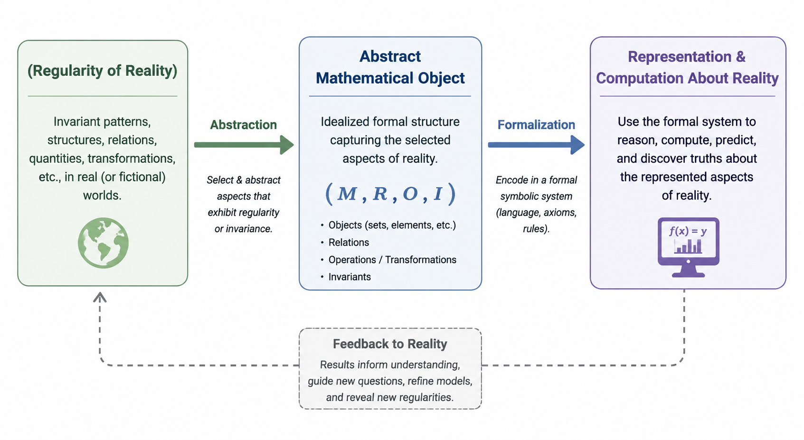

# Mathematical

> In this set of notes we will explore  Mathematics — a  **Epistemic Framework Domain** `(EFD).`
> 

> **Mathematics** is the activity dedicated to the **`creation, exploration and discovery`** of —formal symbolic systems whose **`abstract mathematical elements (objects, structures and relations, etc)` mediate** the representation, reasoning, and computation **over aspects**  of the real, hypothetical,  or fictional worlds. This is **achieved** through the **encoding, by abstract mathematical elements** of  **formally characterizable aspects** of entities, processes, and systems—including their quantitative, structural, spatial, relational, transformational, informational, probabilistic, and other **formalizable characteristics — providing** rigorous deduction, computation, prediction, and the discovery of fundamental truths.  Reality inspires our tools, and through those tools we describe, understand, and gain power over it.
> 

> The art of mathematics extends beyond formal deduction: it employs heuristic, abductive, inductive, analogical, computational, and exploratory modes of reasoning to generate concepts, conjectures, representations, and frameworks. These creative processes allow mathematicians to discover hidden patterns, construct new abstractions, and expand the expressive and explanatory power of mathematical knowledge.
> 

Mathematics is the recursive process by which humans encode the regular dimension (space, quantity, measure)  into abstract formal systems, and use those systems to expand their capacity to understand, predict, and transform reality.

Reality informs the creation of mathematical symbols, and we use those symbols to reason about reality.

> **Note:** In Computer Science, solutions are often constructed in a process-oriented manner—incrementally building up, one step at a time—and are frequently inductive in nature.
> 

> Mathematics: How do we formalize **types of reasoning processes** in which some quantity or quality intervenes? “T**ypes of reasoning processes” as counting, adding things, removing things,  etc.** We can call this process abstraction and the result entity abstraction.
> 

> **Mathematical practice** = the full cognitive activity (intuition, exploration, conjecture, proof, computation, communication).
> 

> **Mathematical validity** = the formal verification of claims within a chosen axiomatic framework.
> 

> **Mathematical application** = the mapping of mathematical structures onto phenomena in the world.
> 

## Study Tip

> Tip: Study mathematics as a living story, tracing its historical arc through the problems that inspired it, the ideas that shaped it, the frameworks that unified it, and the proofs that revealed its truths.
> 

> This strategy invites you to explore math as a living, breathing story, unfolding in four natural stages:
> 
1. **Motivational Problems**: Begin where mathematicians began—with the questions that stirred their imagination and demanded solutions. From the ancient puzzles of geometry to the riddles of infinity, let the problems draw you in, for they are the seeds from which great ideas grow.
2. **Ideas and Concepts**: Dive into the raw, intuitive notions that arise from these problems. Discover how simple insights, sparked by necessity or wonder, evolved into profound concepts that underpin entire fields of study.
3. **[Cohesive Mental Framework] Unifying Formalisms**: Witness the artistry of mathematics as scattered ideas are woven into elegant frameworks. Appreciate the genius of those who saw connections where others saw only chaos, forging bridges between seemingly unrelated realms.
4. **Proofs**: Finally, step into the architect's role. Engage with proofs not as mere formalities, but as the very essence of mathematical thought—a means to solidify intuition, challenge assumptions, and reveal the unassailable truth.

## What are the fundamental regularities of reality that mathematics exploits?

> **Quantitative Characterization** refers to the process of assigning numerical values to the properties or behaviors of a system or element in order to describe, analyze, and model its measurable aspects and relationships within a defined framework.
> 

> **Form Characterization** refers to the process of defining and analyzing the structural or geometric properties of a system or element, focusing on its shape, configuration, and relational organization within a given context.
> 

> **Change Characterization** refers to the process of quantifying and modeling the variation of a system's properties over time or across conditions, capturing dynamics such as rates, transformations, or transitions within a formal framework.
> 

> **Note:** The term **quantity** is used here in its broad sense to denote any numerically characterizable aspect of reality. It encompasses both **discrete quantities**, determined through **counting** or **enumeration**, and **continuous quantities**, determined through **measurement**.
> 

| Fundamental Regularity | Description | Representative Mathematical Framework(s) |
| --- | --- | --- |
| **Numerically Characterizable Aspect  (Quantity, Enumeration, Measurement)** | Entities can be counted, measured, and compared. | Arithmetic, Number Theory |
| **Structure** | Systems possess internal organization composed of parts and wholes. | Set Theory, Algebra |
| **Relation** | Entities stand in relationships with one another. | Graph Theory, Relation Theory |
| **Order** | Entities can be arranged according to precedence, ranking, or inclusion. | Order Theory |
| **Space** | Objects occupy positions and exhibit geometric form. | Geometry |
| **Continuity** | Systems can vary continuously without discrete jumps. | Topology, Analysis |
| **Transformation** | Systems can change while preserving identifiable properties. | Algebra, Group Theory |
| **Symmetry** | Different configurations exhibit the same underlying structure. | Group Theory |
| **Invariance** | Certain properties remain unchanged under specified transformations. | Geometry, Topology, Group Theory |
| **Dynamics** | Systems evolve over time according to rules. | Dynamical Systems, Differential Equations |
| **Uncertainty** | Outcomes may not be deterministic but follow describable distributions. | Probability Theory |
| **Variation** | Observations differ across samples or populations. | Statistics |
| **Information** | Systems can encode, transmit, and process information. | Information Theory |
| **Optimization** | Among many possibilities, some satisfy objectives better than others. | Optimization Theory |
| **Computation** | Rules can be executed mechanically to produce results. | Computability Theory, Algorithm Theory |
| **Hierarchy** | Systems can be organized into nested levels of abstraction or inclusion. | Order Theory, Category Theory |
| **Location** ("where") |  |  |
| **Distance** ("how far") |  |  |
| **Direction** ("which way") |  |  |
| **Adjacency** ("what touches what") |  |  |
| **Containment** ("inside/outside") |  |  |
| **Connectivity** ("what is connected") |  |  |
| **Curvature** ("how space bends") |  |  |
| **Symmetry** ("what transformations leave something unchanged") |  |  |
| **Dimension** ("how many independent directions exist") |  |  |

## Why do we need mathematical frameworks to reason about reality, rather than relying on ad hoc reasoning or simpler conceptual structures?

| Capability | Informal conceptual structures | Mathematical frameworks |
| --- | --- | --- |
| Precision | Ambiguous concepts | Explicit definitions and relations |
| Consistency | Hard to detect contradictions | Formal proof and logical constraint |
| Quantification | Qualitative comparison | Measurement and numerical representation |
| Generalization | Case-based reasoning | Abstract structures applicable across domains |
| Prediction | Narrative expectations | Derivable consequences from models |
| Compression | Many observations described separately | Compact representation through equations/structures |
| Invariance detection | Difficult to identify deep patterns | Formalization exposes conserved relationships |
| Cumulative knowledge | Depends on interpretation | Builds upon formal results |

### Two System Description Strategies

| **Aspect** | **Constraint-Based (Parametric)** | **Generative-Based** |
| --- | --- | --- |
| **Core Idea** | Define a system by rules, conditions, or constraints that its components must satisfy. | Define a system by a process or mechanism that generates all valid instances. |
| **Focus** | Characterizes the space of admissible configurations without specifying how to produce them. | Focuses on mechanisms or rules that actively produce valid configurations. |
| **Representation** | Equations, inequalities, rules, parametric constraints. | Algorithms, recursive procedures, generative grammars, procedural rules. |
| **Purpose** | Understand limits, feasibility, and structural properties of a system. | Model causality, procedural structure, or construction processes. |
| **Strength** | Explicitly defines what is valid; good for verification and analysis. | Provides a constructive view; good for simulation, exploration, and synthesis. |
| **Limitation** | May not provide a method to construct examples directly. | May be less transparent about constraints; can be computationally expensive. |

## What value do Mathematical Epistemic Frameworks provide?

| Capability | Value Provided |
| --- | --- |
| **Abstraction** | Isolate relevant aspects while ignoring irrelevant detail. |
| **Representation** | Encode phenomena as precise mathematical objects. |
| **Formalization** | Define concepts unambiguously through formal languages and axioms. |
| **Computation** | Enable algorithmic manipulation of representations. |
| **Deduction** | Derive valid conclusions from explicit assumptions. |
| **Prediction** | Infer consequences of models before observation or experimentation. |
| **Generalization** | Establish principles that apply across entire classes of systems. |
| **Verification** | Provide rigorous proof of correctness and consistency within the framework. |
| **Communication** | Supply a universal symbolic language for expressing knowledge. |
| **Model Construction** | Build simplified but faithful representations of complex systems. |

## Conceptual Model

Conceptual Model: Mathematical

## References

- [Pure mathematics](https://en.wikipedia.org/wiki/Pure_mathematics)
- [Applied mathematics](https://en.wikipedia.org/wiki/Applied_mathematics)
- https://en.wikipedia.org/wiki/Mathematics
- [Foundations of mathematics](https://en.wikipedia.org/wiki/Foundations_of_mathematics)
- https://en.wikipedia.org/wiki/Nicolas_Bourbaki
- [History of mathematical notation](https://en.wikipedia.org/wiki/History_of_mathematical_notation)
- [Is Mathematics Obsolete with Jeremy Avigad](https://www.youtube.com/watch?v=lE48QtO4xBQ&t=1367s)
- https://en.wikipedia.org/wiki/Glossary_of_mathematical_symbols
- Timeline of Mathematics  / [https://mathigon.org/timeline](https://mathigon.org/timeline)
- The Map of Mathematics / [https://mathmap.quantamagazine.org/map/](https://mathmap.quantamagazine.org/map/)
- [‣](https://app.notion.com/p/1d6598edb790805cb270e81511c00875?pvs=21)
- [A Guide to Study](https://app.notion.com/p/A-Guide-to-Study-c24ba1c6d4084de1b741ff4fef7a1749?pvs=21)
- [Numerical Cognition](https://app.notion.com/p/Numerical-Cognition-176c0f5171ec801c954cd4c7e71c4004?pvs=21)
- [A Guide to Mathematical Frameworks](https://app.notion.com/p/A-Guide-to-Mathematical-Frameworks-35e15755de94447d9e68e05e30ab46eb?pvs=21)
- https://en.wikipedia.org/wiki/List_of_theorems
