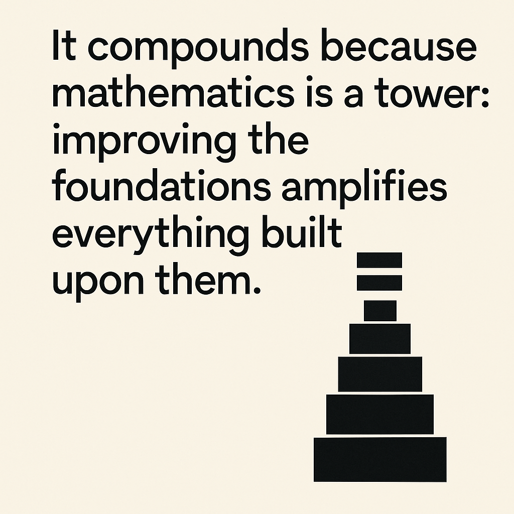

# Equation

 : Matrix (Matrix%20171c0f5171ec80c58898c4e26151fbb8.md)

> In mathematics, is also used to define terms.
> 

> A **statement asserting** the equality of two expressions.
> 

> La palabra **"ecuación"** proviene del latín **"aequatio"**, que a su vez deriva del verbo **"aequare"**, que significa **"igualar"** o **"hacer igual"**. Este verbo está relacionado con la raíz **"aequus"**, que significa **"igual"** o **"equilibrado"**.
> 

## Taxonomy

| **Class of Equations** | **Description** | **Common Applications** |
| --- | --- | --- |
| **Algebraic Equations** | Equations involving variables raised to whole-number powers, typically in the form $P(x) = 0$, where  $P$ is a polynomial. | Solving for unknowns in finance, engineering, and physics. |
| **Differential Equations** | Equations that involve derivatives of a function. They can be ordinary (ODE) or partial (PDE). | Modeling physical phenomena (e.g., heat transfer, population growth). |
| **Difference Equations** | Equations that express a relationship between discrete values of a sequence. | Used in digital signal processing, economics, and population models. |
| **Integral Equations** | Equations in which an unknown function appears under an integral sign. | Common in physics (e.g., potential theory) and engineering (e.g., control systems). |
| **Functional Equations** | Equations in which the unknowns are functions rather than simple variables. | Used in functional analysis, number theory, and dynamical systems. |
| **Algebraic-Differential Equations** | Equations that involve both algebraic expressions and derivatives. | Applied in control theory and fluid dynamics. |
| **Transcendental Equations** | Equations that involve transcendental functions (e.g., exponential, logarithmic, trigonometric). | Common in physics and engineering, such as in wave equations. |
| **Partial Differential Equations (PDEs)** | Equations that involve multiple independent variables and their partial derivatives. | Used in heat conduction, fluid dynamics, and financial mathematics. |
| **Ordinary Differential Equations (ODEs)** | Equations that involve a single independent variable and its derivatives. | Applications include population models and harmonic motion. |
| **Nonlinear Equations** | Equations in which the unknown variable appears in a nonlinear form. | Common in chaos theory, circuit analysis, and structural analysis. |
| **Linear Equations** | Equations that can be expressed in the form  $ax + b = 0$ for one variable or as a matrix equation $Ax = b$  for multiple variables. | Foundational in algebra, statistics, and engineering. |
| **Homogeneous Equations** | Equations where all terms are of the same degree, typically in the context of linear equations. | Common in differential equations and system stability analysis. |
| **Non-Homogeneous Equations** | Equations that include a term that does not depend on the unknown function or variable. | Used in control systems and dynamic modeling. |
| **System of Equations** | Sets of equations with multiple variables that are solved simultaneously. | Applications in economics, engineering, and computer science. |

## Deep Analysis

> What is the deepest thing that can be said about (=)? Look, even apparently simple things like (=) are fascinating and deep; so make sure to go back; and back again on the simplest of the things; because it compounds.
> 

> It compounds because mathematics is a tower: improving the foundations amplifies everything built upon them.
> 

> It’s **not just a symbol of sameness**—it's a **philosophical operator** that binds the world together, allowing us to reason, compute, model, and ultimately, to understand.
> 

> The equals sign is the symbolic bridge between appearance and essence, between expression and truth, between transformation and identity.
> 

💡 At its core:

> “=” is a statement that two different expressions are, in essence, the same.
> 

But this seemingly simple idea touches **some of the most profound themes** in philosophy, mathematics, logic, and even physics:

### 1. **Equality as Identity (Philosophy & Logic)**

In formal logic, “=” is not just about arithmetic; it's about **identity**—the idea that two names or forms refer to **the same entity**.

- **Frege (19th century)** distinguished between:
    - **Sense** (the way of presenting something) and
    - **Reference** (what it refers to).
    
    So in:
    
    $3 + 2 = 5$
    
    both sides have different *sense* (they look different), but the *reference* (value) is the same.
    

### 2. **Equality as Invariance (Mathematics & Physics)**

Mathematically, equations are often **invariance statements**—claims that something remains unchanged under transformation.

- In **algebra**: ax+b=cax + b = c implies a transformation that holds identity across values of xx.
- In **physics**:
    
    $E = mc^2$ is not just an equation—it's a profound identity between **mass and energy**, revealing their sameness under different manifestations.
    

### 3. **Equality as Constraint (Systems Theory)**

In systems, an equation often encodes a **constraint**: a rule that binds variables together. In this view:

- “=” is a **coupling operator**, linking elements into a coherent structure.
- It doesn't just say "these are the same," but **"these must co-vary in this exact way."**

### 4. **Equality vs. Equivalence (Mathematics)**

Equality ("=") is absolute; two things are exactly the same.

But mathematicians distinguish it from **equivalence (~)**:

- **Equivalence** means "same in some respect" (e.g., modular arithmetic, category theory).
- Equality is **strict**, equivalence is **contextual**.

Understanding this distinction is key in higher mathematics, especially in **algebraic topology**, **category theory**, and **homotopy type theory**, where the **nature of equality itself is questioned**.

### 5. **Equality as a Human Invention (History of Notation)**

The "=" symbol was introduced in **1557** by **Robert Recorde**, who wrote:

> “...to avoid the tedious repetition of the words 'is equal to', I will set, as I often do in work use, a pair of parallels or twin lines of one length, thus: ‘=’, because no two things can be more equal.”
> 

## References

- https://en.wikipedia.org/wiki/Equation
- https://en.wikipedia.org/wiki/Parametric_equation
