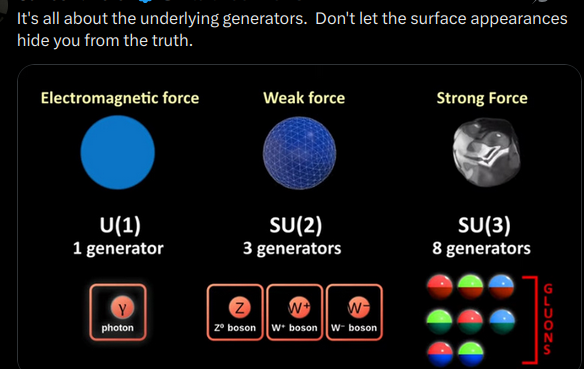

# Group

> **Group Theory**: Group theory studies groups, which are algebraic structures that satisfy certain axioms, such as closure, associativity, identity, and inverse. Group theory is used in many areas of mathematics, including number theory, geometry, and topology.
> 

> **Sets** equipped with an operation that combines any two elements to form a third element, satisfying four conditions (closure, associativity, identity, and invertibility).
> 

> In **geometry groups** arise naturally in the study of symmetries and geometric transformations: The symmetries of an object from a group, called the symmetry group of the object, and the transformations of a given type form a general group.
> 

> **Generator**:  …
> 

> **Semigroups**: Semigroups are sets equipped with an associative binary operation. They are used to model systems that exhibit associative behavior, such as string concatenation or composition of functions.
> 

> **Group Theory**: Group theory studies groups, which are algebraic structures that satisfy certain axioms, such as closure, associativity, identity, and inverse. Group theory is used in many areas of mathematics, including number theory, geometry, and topology.
> 

> **Sets** equipped with an operation that combines any two elements to form a third element, satisfying four conditions (closure, associativity, identity, and invertibility).
> 

> In **geometry groups** arise naturally in the study of symmetries and geometric transformations: The symmetries of an object from a group, called the symmetry group of the object, and the transformations of a given type form a general group.
> 

> **Generator**:  …
> 

### Action

> A [group action](https://en.wikipedia.org/wiki/Group_action) is a mapping that preserves the structure between a group and a set.
> 

### List of Groups

> 

| **Category** | **Group Type** | **Description** | **Uses** |
| --- | --- | --- | --- |
| Trivial Group | **Trivial Group** | The simplest group, consisting of only the identity element. | Foundational in defining group homomorphisms and kernels. |
| Finite Abelian Group | **Cyclic Groups (ℤₙ)** | Groups generated by a single element, isomorphic to integers modulo $n$. | Cryptography (e.g., RSA), number theory, and symmetry in discrete structures. |
| Finite Non-Abelian Group | **Symmetric Group (Sₙ)** | The group of all permutations of $n$ elements. | Combinatorics, solving polynomial equations (Galois theory), and symmetry in physics. |
| Finite Non-Abelian Group | **Alternating Group (Aₙ)** | The subgroup of $Sₙ$) consisting of even permutations. | Simplifying polynomial equations, studying simple groups, and error-correcting codes. |
| Finite Non-Abelian Group | **Dihedral Group (Dₙ)** | The group of symmetries of a regular  $n$-gon (rotations and reflections). | Crystallography, molecular symmetry, and geometric transformations. |
| Finite Non-Abelian Group | **Quaternion Group (Q₈)** | A group of 8 elements representing quaternion units under multiplication. | Representing 3D rotations in computer graphics and quantum mechanics. |
| Infinite Non-Abelian Group | **General Linear Group (GLₙ)** | The group of invertible  $n$ $\times$ n matrices over a field. | Linear algebra, physics (e.g., Lorentz transformations), and differential equations. |
| Infinite Non-Abelian Group | **Special Linear Group (SLₙ)** | The subgroup of  $GLₙ$ with determinant 1. | Studying volume-preserving transformations in geometry and physics. |
| Infinite Non-Abelian Group | **Orthogonal Group (Oₙ)** | The group of orthogonal $n \times n$ matrices (preserving inner products). | Physics (rotations and reflections in space), robotics, and computer vision. |
| Infinite Non-Abelian Group | **Special Orthogonal Group (SOₙ)** | The subgroup of $Oₙ$ with determinant 1 (rotations in $\mathbb{R}^n$ . | Describing rotations in 3D space (e.g., rigid body dynamics) and quantum mechanics. |
| Infinite Non-Abelian Group | **Unitary Group (Uₙ)** | The group of unitary $n \times n$ matrices over complex numbers. | Quantum mechanics (e.g., quantum gates in quantum computing) and signal processing. |
| Infinite Non-Abelian Group | **Special Unitary Group (SUₙ)** | The subgroup of  $Uₙ$ with determinant 1. | Particle physics (e.g., describing gauge symmetries in the Standard Model). |
| Infinite Non-Abelian Group | **Lorentz Group** | The group of transformations preserving the spacetime interval in relativity. | Special and general relativity, high-energy physics. |
| Finite or Infinite Group | **Galois Group** | The group of field automorphisms preserving a field extension. | Solving polynomial equations (Galois theory), cryptography, and number theory. |
| Infinite Non-Abelian Group | **Free Group (Fₙ)** | A group generated by $n$ symbols with no relations. | Topology (fundamental group of spaces), formal language theory, and combinatorial group theory. |
| Infinite Non-Abelian Group | **Modular Group (PSL₂(ℤ))** | The group of linear fractional transformations  $z \mapsto \frac{az+b}{cz+d}$. | Number theory (modular forms), hyperbolic geometry, and string theory. |
| Finite Non-Abelian Group | **Monster Group (M)** | The largest sporadic simple group, orde  $\approx 8 \times 10^{53}$. | Theoretical physics (e.g., moonshine conjecture), and classification of finite simple groups. |
| Finite Non-Abelian Group | **Mathieu Groups (M₁₁, M₁₂, etc.)** | Sporadic simple groups arising in combinatorics and group theory. | Error-correcting codes, combinatorial designs, and theoretical group theory. |
| Infinite Non-Abelian Group | **Heisenberg Group** | A group of upper triangular matrices with 1s on the diagonal. | Quantum mechanics (Heisenberg uncertainty principle), harmonic analysis, and nilpotent group theory. |
| Infinite Non-Abelian Group | **Braid Group (Bₙ)** | The group of braids on $n$ strands, generalizing the symmetric group. | Topology (knot theory), cryptography (braid-based cryptography), and quantum computing. |
| … | **Permutation Group** | … | … |

References

- [Group](https://www.wikiwand.com/en/Group_(mathematics))
- [Subgroup](https://en.wikipedia.org/wiki/Subgroup)
- [Group (mathematics)](https://en.wikipedia.org/wiki/Group_(mathematics))
- [Representation theory](https://www.wikiwand.com/en/Representation_theory)
- [Representation Theory](https://math.berkeley.edu/~teleman/math/RepThry.pdf)
- https://en.wikipedia.org/wiki/Group_theory
- https://en.wikipedia.org/wiki/Special_linear_group
- https://en.wikipedia.org/wiki/List_of_group_theory_topics
- https://en.wikipedia.org/wiki/Generating_set_of_a_group
- https://en.wikipedia.org/wiki/Group_(mathematics)
