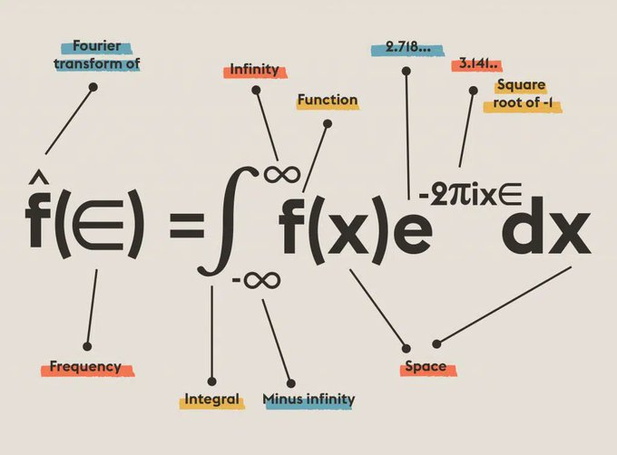

# Integral Transform

 : Operator (Operator%2096b9329acc2b493388cda715c8e66caa.md)

> An **integral transform** is a **mathematical operation** that maps a function into another function through integration, often used to simplify the analysis of functions or equations in different domains.
> 

## References

- [Integral Transform](https://en.wikipedia.org/wiki/Integral_transform)
- [Generalized Function](https://en.wikipedia.org/wiki/Generalized_function)
