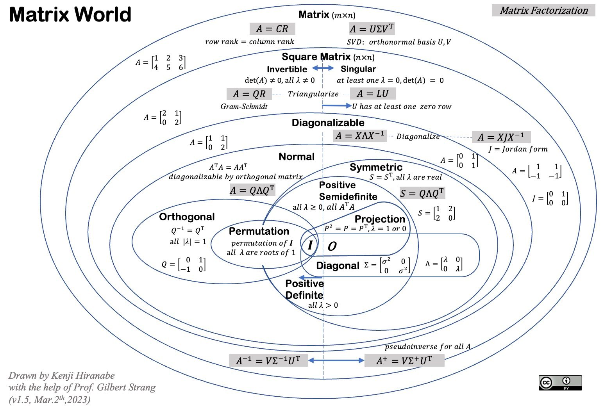

# Matrix

 : Equation (Equation%2011dc0f5171ec80d8b501f8222292a9d6.md), Tensor (Tensor%2000b35866438f431f90e06cc223bd8eb5.md), Adjoin Operator (Adjoin%20Operator%201a1c0f5171ec805a9f61c4e37e037c9c.md), Span (Span%201bac0f5171ec808eb090c0454e3cc1ad.md), Linear Operator (Linear%20Operator%20171c0f5171ec80e88b2fd6f9c6fae223.md), Scatter Matrix (Scatter%20Matrix%20207c0f5171ec80cd9dd4c3514f714cb3.md), Matrix Factorization (Matrix%20Factorization%20fab65697c6804784b5c47684ef92b6df.md), Linear Space (Linear%20Space%20b935942a1a064729b3f2be42d174923a.md), Linear  Algebra (Linear%20Algebra%20d4ca395ec6c545c1bf2387d2fbdc732f.md)

> Rectangular arrays of numbers, symbols, or expressions arranged in rows and columns.
> 

> A **matrix is a rectangular** array of numbers, symbols, or expressions arranged in rows and columns, often used to represent and manipulate data or perform mathematical operations such as addition, subtraction, multiplication, and inversion.
> 

> A **matrix is a rectangular** array of numbers, symbols, or expressions arranged in rows and columns, often used to represent and manipulate data or perform mathematical operations such as addition, subtraction, multiplication, and inversion.
> 

> **Linear Algebra** is the branch of mathematics concerned with vector spaces, linear transformations, and systems of linear equations, fundamental to many areas of mathematics and its applications in science and engineering.
> 

> A **linear system** is a **mathematical model** **representing relationships between variables** that can be described by linear equations, where each equation is a straight line when plotted on a graph.
> 

> **Linear algebra's** **representational power** lies in its ability to model and manipulate complex systems, transformations, and data structures through vectors, matrices, and operations that simplify problem-solving across diverse fields.
> 

Guiding questions:

- What is the **ontic map** of a mathematical matrix?
    - What are its **properties**? Which are the types of properties?
    - What is the **matrix type space**?
    - What are the **operations** defined on matrices?
    - What is the **representational capacity** of a matrix,  both intra-mathematics, and for ontic reality?
    - What is the **affirmation (propositional) space** about matrices? **What is the list** of known affirmations about a matrix?
- What is the origin of the idea of a determinnand?  What dose a determinsn encoded?
- Which ar teh computiaonl techniques used to operation onmatrix?
- How to decomposed ourstudy of a matrix?
    - **Algebraic layer** → ring, field interactions
    - **Geometric layer** → transformations, invariants
    - **Spectral layer** → eigenstructure, stability
    - **Computational layer** → decompositions, solvability
- Can we used a matrix to encode a non linear operator?

---

QA:

- What is  the relation of a span and a basis?
- …

## List of Functions

> 

| **Operator** | **Symbol** | **Description** | **Conditions** | **Example** |
| --- | --- | --- | --- | --- |
| **Addition** | $+$ | Adds corresponding elements of two matrices. | Matrices must have the same dimensions. | $A + B = \begin{pmatrix} a_{11}+b_{11} & a_{12}+b_{12} \\ a_{21}+b_{21} & a_{22}+b_{22} \end{pmatrix}$ |
| **Subtraction** | $-$ | Subtracts corresponding elements of two matrices. | Matrices must have the same dimensions. | $A - B = \begin{pmatrix} a_{11}-b_{11} & a_{12}-b_{12} \\ a_{21}-b_{21} & a_{22}-b_{22} \end{pmatrix}$ |
| **Scalar Multiplication** | $\cdot$ | Multiplies every element of a matrix by a scalar (constant). | None. | $k \cdot A = \begin{pmatrix} k \cdot a_{11} & k \cdot a_{12} \\ k \cdot a_{21} & k \cdot a_{22} \end{pmatrix}$ |
| **Matrix Multiplication** | $\times$ | Multiplies two matrices using the dot product of rows and columns. | Number of columns in $A$ must equal number of rows in $B$. | $c_{ij} = \sum_{k=1}^{n} a_{ik} \cdot b_{kj}$ |
| **Transpose** | $^T$ | Flips a matrix over its diagonal, turning rows into columns and vice versa. | None. | $A^T = \begin{pmatrix} a_{11} & a_{21} \\ a_{12} & a_{22} \end{pmatrix}$ |
| **Inverse** | $^{-1}$ | Finds a matrix $A^{-1}$ such that $A \times A^{-1} = I$. | $A$ must be square and invertible (determinant ≠ 0). | $A \times A^{-1} = I$, where $I$ is the identity matrix. |
| **Determinant** | $\det$ | Computes a scalar value representing the matrix's scaling factor. | $A$ must be square. | $\det(A) = a_{11}a_{22} - a_{12}a_{21}$ for $2 \times 2$. |
| **Trace** | $\text{tr}$ | Sum of the diagonal elements of a square matrix. | $A$ must be square. | $\text{tr}(A) = a_{11} + a_{22} + \dots + a_{nn}$ |
| **Hadamard Product** | $\circ$ | Element-wise multiplication of two matrices. | Matrices must have the same dimensions. | $A \circ B = \begin{pmatrix} a_{11} \cdot b_{11} & a_{12} \cdot b_{12} \\ a_{21} \cdot b_{21} & a_{22} \cdot b_{22} \end{pmatrix}$ |
| **Kronecker Product** | $\otimes$ | Computes the tensor product of two matrices, resulting in a block matrix. | None. | $A \otimes B = \begin{pmatrix} a_{11}B & a_{12}B \\ a_{21}B & a_{22}B \end{pmatrix}$ |
| **Norm …** |  |  |  |  |
| **Power** |  |  |  |  |
| **Adjugate (Adjoint)** |  |  |  |  |
| **Minor** |  |  |  |  |
| **Rank** |  |  |  |  |
| **Null Space (Kernel)** |  |  |  |  |
| **Column Space (Image)** |  |  |  |  |
| **Row Space** |  |  |  |  |
| **Singular Value Decomposition (SVD)** |  |  |  |  |
| **QR Decomposition** |  |  |  |  |
| **Cholesky Decomposition** |  |  |  |  |
| **Eigenvalue** |  |  |  |  |
| **Eigenvector** |  |  |  |  |
| **Cofactor Matrix** |  |  |  |  |
| **LU Decomposition** |  |  |  |  |
| **Logarithm** |  |  |  |  |

## **Matrix Multiplication**

> You want the general definition of matrix multiplication, but with explicit **row-column dot product notation** (e.g., $\text{row}_i \cdot \text{col}_j$). Here’s the precise and formal way to write it:
> 

The product $C = A \cdot B$ is an $m \times p$ matrix where each element $c_{ij}$ is the dot product of the  $i$-th row of  $A$ and the  $j$-th column of  $B$:

$c_{ij} = \sum_{k=1}^{n} a_{ik} \cdot b_{kj}$

**Matrix Multiplication (Row-Column Dot Product Notation)**

Let:

- $A$  be an $m \times n$ matrix with rows $\text{ar}_1, \text{ar}_2, \dots, \text{ar}_m$,
- B be an $n \times p$ matrix with columns $\text{bc}_1, \text{bc}_2, \dots, \text{bc}_p$.

$A \cdot B =
\begin{pmatrix}
\text{ar}_1 \cdot \text{bc}_1 & \text{ar}_1 \cdot \text{bc}_2 & \cdots & \text{ar}_1 \cdot \text{bc}_p \\
\text{ar}_2 \cdot \text{bc}_1 & \text{ar}_2 \cdot \text{bc}_2 & \cdots & \text{ar}_2 \cdot \text{bc}_p \\
\vdots & \vdots & \ddots & \vdots \\
\text{ar}_m \cdot \text{bc}_1 & \text{ar}_m \cdot \text{bc}_2 & \cdots & \text{ar}_m \cdot \text{bc}_p
\end{pmatrix}$

## Matrix Similarity

> 

## **Linear Span**

> A **linear** **span** is the set of all possible linear combinations of a given set of vectors, representing the subspace that these vectors generate.
> 

> See more here [Span](span.md).
> 

## Matrix Sub Spaces

> A **matrix subspace** is a vector space formed by the set of all linear combinations of the rows or columns of a matrix, representing different aspects of the matrix's structure and solutions.
> 

Here is a list of the **matrix subspaces** that are commonly encountered in linear algebra, each representing different parts of a matrix and their associated spaces:

### **Column Space (Range or Image)**

- The **column space** of a matrix $A \in \mathbb{R}^{m \times n}$ is the subspace of $\mathbb{R}^m$ spanned by the columns of $A$.
- It represents all possible **linear combinations** of the columns of the matrix and is key in understanding the **rank** of the matrix.
    
    $\operatorname{Col}(A) = \{ A x \mid x \in \mathbb{R}^n \}$
    

### **Row Space**

- The **row space** of a matrix is the subspace of $\mathbb{R}^n$ spanned by the rows of $A$.
- It is equivalent to the **column space** of the transpose of the matrix $A^T$.
    
    $\operatorname{Row}(A) = \operatorname{Col}(A^T)$
    

### **Null Space (Kernel)**

- The **null space** of a matrix $A$ consists of all vectors $x$ in $\mathbb{R}^n$ such that $A x = 0$.
- It captures all the **solutions** to the homogeneous system of equations $A x = 0$.
    
    $\operatorname{Null}(A) = \{ x \in \mathbb{R}^n \mid A x = 0 \}$
    

### **Left Null Space (Kernel of $A^T$)**

- The **left null space** of a matrix AA is the null space of the transpose $A^T$, i.e., it consists of all vectors yy such that $A^T y = 0$.
    
    $\operatorname{Null}(A^T) = \{ y \in \mathbb{R}^m \mid A^T y = 0 \}$
    

### **Range Space of the Transpose (Dual Space)**

- The **range space** of $A^T$, also called the **dual space** of the column space, refers to the span of the rows of the matrix AA, which is equivalent to the row space of $A$.
    
    $\operatorname{Range}(A^T) = \operatorname{Row}(A)$
    

## Taxonomy

| Matrix Type | Description (optional) |
| --- | --- |
| Square Matrices | Matrices with the same number of rows and columns |
| Symmetric Matrices | Equal to their transpose: $A = A^T$ |
| Hermitian Matrices | Equal to their conjugate transpose: $A = A^*$ |
| Orthogonal Matrices | Transpose equals inverse: $A^T A = I$ |
| Unitary Matrices | Conjugate transpose equals inverse:  $A^* A = I$ |
| Positive Definite Matrices | All eigenvalues are positive |
| Random Matrix | Matrix with randomly distributed entries |

## Encoding Linear Operator

> Matrices can encode **linear operators** (also called linear transformations) because they **represent how those operators act on vectors** in a finite-dimensional vector space.
> 

Here's a clear breakdown of how and why this works:

📌 1. **Linear Operators and Vector Spaces**

A **linear operator** $T$ on a vector space $V$ maps vectors to vectors:  $T: V \to V$ satisfying linearity: $T(a\vec{v} + b\vec{w}) = aT(\vec{v}) + bT(\vec{w})$

📌 2. **Choosing a Basis**

To encode $T$ as a matrix, you must **choose a basis** $\{ \vec{e}_1, \dots, \vec{e}_n \}$ of the vector space $V$.

📌 3. **Action of $T$ on the Basis**

Apply $T$ to each basis vector: $T(\vec{e}_j) = \sum_{i=1}^n a_{ij} \vec{e}_i$  The scalars $a_{ij}$ are the components of the resulting vector.

📌 4. **Matrix Representation**

The matrix $A = [a_{ij}]$ is the **matrix representation of $T$** in the chosen basis. Each column of the matrix is how $T$ acts on one basis vector:

$A = \begin{bmatrix}
| & | & & | \\
T(\vec{e}_1) & T(\vec{e}_2) & \dots & T(\vec{e}_n) \\
| & | & & |
\end{bmatrix}$

📌 5. **Applying the Operator via Matrix Multiplication**

If  $\vec{v} \in V$ is expressed in the basis as a column vector $[v]_B$, then:  $[T(\vec{v})]_B = A [\vec{v}]_B$

So the matrix **acts on vectors** via multiplication — just like the operator.

🧠 Why It Works

This works because **matrix multiplication mirrors the composition of linear functions**:

- Matrices = algebraic encoding of function behavior.
- Changing basis changes the matrix, not the operator.
- Infinite-dimensional analog: operators are encoded by **integral kernels** or **differential expressions** (functional analysis).

## Representation

> In which ways can we represent a matrix? What’s the goal of that?
> 
- Bilinear Form
- …

## Matrix Representational Power

> Matrices have significant representational power in various fields of mathematics and computer science.
> 

Here are some aspects of their representational power:

- **Linear Transformations**: Matrices can represent linear transformations between vector spaces. They allow for the concise representation and computation of transformations such as rotations, scalings, reflections, and shears. By combining and composing matrices, complex transformations can be achieved efficiently.
- **Systems of Equations**: Matrices provide a compact representation of systems of linear equations. They allow for the efficient manipulation and solution of systems with large numbers of variables and equations. Matrices also enable techniques such as Gaussian elimination, LU decomposition, and matrix inversion, which are fundamental for solving linear systems.
- **Graphs and Networks**: Matrices, specifically adjacency and incidence matrices, concisely represent graphs and networks. They capture the connectivity and relationships between nodes or vertices. Matrix operations and properties can be used to analyze graph properties, compute paths, find cliques, and study network dynamics.
- **Markov Chains**: Matrices are extensively used to model and analyze Markov chains. The transition matrix, which represents the probabilities of transitioning between states, enables studying stochastic processes' long-term behavior and steady-state distributions.
- **Image Processing**: Matrices are used to represent and process digital images. A matrix element can represent each photo pixel, and operations such as filtering, transformation, and compression can be efficiently applied using matrix operations.
- **Quantum Mechanics**: In quantum mechanics, matrices (expressly, operators) represent physical observables and transformations of quantum states. Matrix operations, such as matrix multiplication and eigenvalue computations, are fundamental for understanding quantum systems and solving problems in quantum mechanics.
- **Data Set (Universal)**: Data sets can be represented as matrices, with rows representing observations and columns representing variables. Matrix operations and factorizations, such as singular value decomposition (SVD) and principal component analysis (PCA), extract meaningful information and reduce dimensionality.

## References

- https://en.wikipedia.org/wiki/LU_decomposition
- https://en.wikipedia.org/wiki/Matrix_multiplication
- https://en.wikipedia.org/wiki/Matrix_multiplication_algorithm
- https://www.ucl.ac.uk/~ucahmto/0005_2021/Ch3.S2.html
- http://matrixmultiplication.xyz/
- https://en.wikipedia.org/wiki/Sinkhorn%27s_theorem
