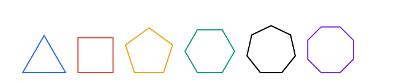

# Polygon

 : Euclidean  Geometry (Euclidean%20Geometry%20858b34433a204b55bb716919101bdcc6.md)

> A **polygon** is a two-dimensional geometric shape that is  defined by a closed path made up of **straight line** segments (sides)  connected end-to-end.
> 

> A **regular** polygon is a special type with sides that are all the same length and angles that are the same size.
> 

## Definition

A **polygon** is a *piecewise-linear, closed, planar figure* defined formally as a **finite cyclic sequence of distinct points** (called *vertices*) in a two-dimensional Euclidean space $\mathbb{R}^2$, joined successively by **straight line segments** (called *edges*) such that:

$P = (v_0, v_1, v_2, \dots, v_{n-1}), \quad v_i \in \mathbb{R}^2, \quad v_i \ne v_{i+1}, \quad v_n = v_0$

where the set of **edges** is:

$E = \{ e_i = \overline{v_i v_{i+1}} \mid i \in \mathbb{Z}_n \}$

and the **polygonal chain** is **simple**, i.e., the edges only intersect at shared endpoints:

$\forall i, j \in \mathbb{Z}_n, \ i \ne j \Rightarrow \operatorname{int}(e_i) \cap \operatorname{int}(e_j) = \emptyset$

This ensures the polygon is **non-self-intersecting**

## Property

- **Sides (Edges):** Straight line segments that form the boundary of the polygon.
- **Vertices (Corners):** Points where two sides meet.
- **Closed Shape:** All sides connect to form a continuous, gap-free loop.
- **Straight Sides Only:** Polygons consist exclusively of straight edges—no curves.
- **Area:** The amount of space enclosed within the polygon.
- **Interior Angles:** The angles formed between adjacent sides inside the polygon.
- **Convexity:** A polygon is **convex** if all interior angles are less than 180° and no vertices point inward.
- **Concavity:** A polygon is **concave** if at least one interior angle is greater than 180°, causing an indentation.

## Taxonomy

> ….
> 

| **Category** | **Type** | **Definition** | **Examples** |
| --- | --- | --- | --- |
| **By Size** | Regular | All sides and angles equal. | Equilateral triangle, square |
|  | Irregular | Sides/angles not equal. | Rectangle (non-square), scalene triangle |
| **By Convexity** | Convex | No interior angle > 180°; no indentations. | Regular polygons, convex quadrilaterals |
|  | Concave (Non-Convex) | At least one interior angle > 180°; has indentations. | Arrowhead, star polygons (pentagram) |
| **By Sides** | Triangle (3) | 3 sides. | Equilateral, isosceles, scalene |
|  | Quadrilateral (4) | 4 sides. | Square, trapezoid, rhombus |
|  | Pentagon (5) | 5 sides. | Regular pentagon, irregular pentagon |
|  | *n*-gon | *n* sides. | Hexagon (6), heptagon (7), etc. |
| **Complexity** | Simple | No intersecting sides. | Convex/concave polygons |
|  | Complex (Self-Intersecting) | Sides cross each other. | Star polygons (e.g., pentagram) |
| **Special Types** | Cyclic | All vertices lie on a circle. | Regular polygons, rectangles |
|  | Equilateral | All sides equal (angles may vary). | Rhombus (non-square) |
|  | Equiangular | All angles equal (sides may vary). | Rectangle (non-square) |

## Regular Polygon

> A **regular** polygon is a special type with sides that are all the same length and angles that are the same size.
> 

## **Trapezoid**

> 

## **Rhombus**

> 

## References

- https://en.wikipedia.org/wiki/Polygon
- https://en.wikipedia.org/wiki/Trapezoid
