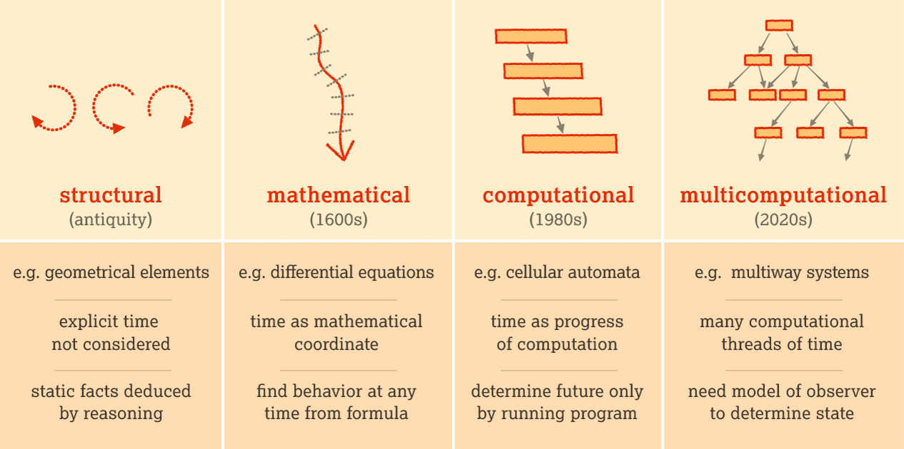

# Modelado

> **Modelling:**  [Piece of Reality  → Data (Observations)] → Formal Representations (Data, Process, etc.) → Testing Explanatory or Predictive Power.
> 

> What we observe is not nature itself, but nature exposed to our method of questioning. - Werner Heisenberg, German physicist
> 

> **Scientific insight** is the profound understanding or discovery that reveals underlying principles or patterns in natural phenomena, often leading to significant advancements in **knowledge** or **technology**.
> 

> An [**organizing principle**](https://en.wikipedia.org/wiki/Organizing_principle) is a core assumption from which everything else by proximity can derive a classification or a value. It is like a central reference point that allows all other objects to be located, often used in a [conceptual framework](https://en.wikipedia.org/wiki/Conceptual_framework).
> 

> **Universal Abstraction for Modelling:** The goal of modelling, in this formulation, is to construct an **intelligent actor** — an entity with an explicit internal architecture capable of receiving inputs, maintaining state, and adapting through training to achieve specified behavioral outcomes.
> 

> **Note:** A model of reality is, fundamentally, an **affirmation about reality** — often a **composite affirmation** built from more basic, fundamental affirmations. However, this is not always strictly the case: in **effective models**, some components of the model may **not correspond directly to affirmations about reality**, but serve as computational or conceptual tools. Still, in general, the **model as a whole represents an affirmation about reality**.
> 

## Modeling Tools

> A **modeling template**, also known as a model template, is a pre-defined structure or framework that provides a standardized format for creating models in a specific domain or context. It serves as a starting point or guide for developing models by providing a consistent structure, variables, relationships, and assumptions that are commonly used within that domain.
> 

> **Mathematics** is the art of clear thinking.
> 

> **Computer Science** is the art of modelling processes.
> 

> **Statistics** is the art of describing phenomena without delving into their underlying mechanisms.
> 

## Systems

> The goal is to create a **universal framework** for **modeling systems**, including **listing natural systems**, developing classifications, and creating tools to facilitate their modeling.
> 

## Model Theory

> Try to develop a theory of modelling.
> 

## Problem

> Let’s say we have a specification of a problem: does it have a solution? If so, is it unique, are there many solutions, or none at all? - For this used the terminology of **Well-Posed Problem**.
> 

> **Determinacy** refers to the property of a system where its **future state is uniquely determined by its initial state and the governing rules/laws**.
> 

> **Characterization of Solutions:** This is a broader goal that includes determining existence, uniqueness, *and* describing the *set* of all solutions (e.g., parameterizing the solution space if there are infinitely many).
> 

> **Well-Posed Problem (Hadamard)**: A problem is well-posed if it satisfies three conditions: (1) a **solution exists (Existence)**, (2) the **solution is unique (Uniqueness),** and (3) the solution's behavior changes continuously with the initial data (**stabilit**y). Existence and uniqueness are the first two pillars of **well-posedness**.
> 

[Causality](causality.md)

[Simulation](simulation.md)

[Optimization](optimization.md)

[Mathematical](mathematical.md)

[Observational](observational.md)

[Decision Making](decision-making.md)

[Signal Processing](signal-processing.md)

[Natural Computing](natural-computing.md)

[Complexity Science](complexity-science.md)

[**Statistical Mechanics**](note.html?n=epistemica/construction/statistical-mechanics.md)

[Dynamical Intelligence](dynamical-intelligence.md)

[Computational Science](computational-science.md)

[Formal Concept Analysis (FCA)](formal-concept-analysis-fca.md)

[**System of Units of Measurement**](system-of-units-of-measurement.md)

[Exploratory Data Analysis (EDA)](exploratory-data-analysis-eda.md)

## References

- [Philosophy](https://app.notion.com/p/Philosophy-ccc223e791024b4181a87d0d2b5d1cec?pvs=21)
- [Epistemic Artifact](https://app.notion.com/p/Epistemic-Artifact-30ec0f5171ec80909e69c302fff36f78?pvs=21)
- [A General Guide to Representation & Estimation](https://app.notion.com/p/A-General-Guide-to-Representation-Estimation-22dc0f5171ec8099a450f1d8f419a67f?pvs=21)
- [‣](https://app.notion.com/p/28b598edb79080a7b96cf1a8365b81c6?pvs=21)
