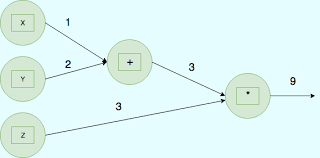

# Computation Graph

> A **computation graph** is a **directed acyclic graph** where nodes represent operations or variables, and edges represent the flow of data or dependencies between operations, used to model and compute functions step by step in fields like deep learning and automatic differentiation.
> 

## References

- [Introduction to Computation Graphs](https://www.cs.cmu.edu/~aarti/Class/10315_Spring22/315S22_Rec6.pdf)
- [Computation graphs and graph computation](http://breandan.net/2020/06/30/graph-computation/)
- [Graph: Abstractions for Structured Computation](https://news.ycombinator.com/item?id=5183236)
- Computational Graph
[https://x.com/karpathy/status/1803963383018066272](https://x.com/karpathy/status/1803963383018066272)
- [Neural Networks, Types, and Functional Programming](https://colah.github.io/posts/2015-09-NN-Types-FP/)
