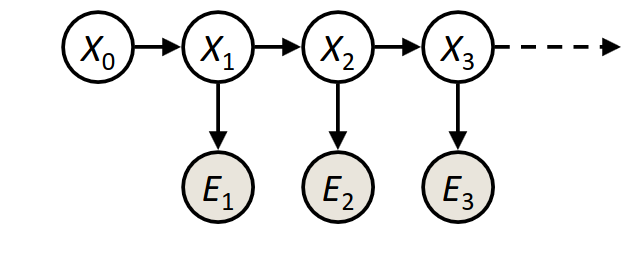
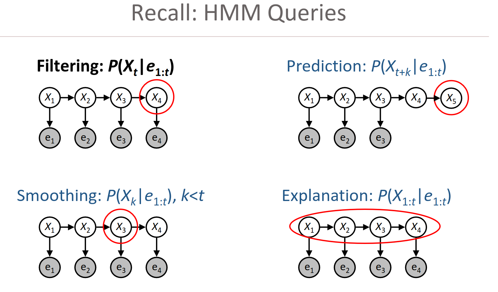

# (HMM) Hidden Markov Model

- Emission Distribution
- Assume the data is generated by several possible data-generating processes, and determine which one is active at each point in time.
- Inferring multiple data generation proceses. (**Mixture Model**)
- How is this representation of reality validated?
- The HMM finds the underlying states by asking:
    - "Which assignment of hidden states makes the observed data most likely under the assumed generative model?"
    - …
- **`…`**  -  **`...`**
- Alternatives:
    - Gaussian Mixture Models (GMM)
    - **Markov Switching Models (MSM)**
- Limitation:
    - The Markov Assumption.
    - **Continuous Re-training**: Market structures change (regime shifts). Professional systems use **rolling windows** or **Walk-Forward Optimization** to periodically retrain the HMM, ensuring the model adapts to recent data rather than stale historical patterns.
    
    | Problem | Consequence |
    | --- | --- |
    | Markets are non-stationary | regimes change |
    | Few true regimes | states may be artificial |
    | Noise dominates | false regimes |
    | Structural breaks | old model becomes invalid |
    | Human behavior changes | transition probabilities change |

A [Hidden Markov Model (HMM)](https://en.wikipedia.org/wiki/Hidden_Markov_model) is a statistical model used to describe a **sequence of observations** where each observation is generated by an underlying process that is not directly observable. It is a type of probabilistic graphical model that is widely used in fields such as speech recognition, natural language processing, bioinformatics, and finance.

The **HMM** consists of two main components:

- **Hidden States**: A sequence of hidden states that are not directly observable, but which generate the observations. Each hidden state represents a particular “state” of the system.
- **Observations**: A sequence of observable outputs that are generated from the hidden states. Each observation represents an outcome that is related to the hidden state.

The key assumption in **HMM** is that the probability distribution of each observation depends only on the underlying hidden state. This means that the probability of observing a particular output depends only on the hidden state that generated it.

The process of learning an **HMM** involves estimating the model parameters from a given dataset. These parameters include the probability distribution of the hidden states and the probability distribution of the observations given the hidden states. The most common approach for estimating the model parameters is the Baum-Welch algorithm, which is a variation of the **Expectation-Maximization (EM)** algorithm.

Once the **HMM** has been learned, it can be used to perform various tasks such as sequence prediction, sequence classification, and sequence generation. For example, in speech recognition, an **HMM** can be trained on a dataset of speech signals and used to recognize spoken words based on the observed signal. In bioinformatics, HMMs can be used to model gene and protein sequences and predict their functions.

## What can we do with a `Markov Model`?

## References

- Michael Collins: Discriminative Training Methods for Hidden Markov Models: Theory and Experiments with Perceptron Algorithms, EMNLP 2002.
- Rabiner, L. R. (1989). A Tutorial on Hidden Markov Models and Selected Applications in Speech Recognition. Proceedings of the IEEE, 77(2), 257–286.
- [Hidden Markov Model](https://en.wikipedia.org/wiki/Hidden_Markov_model)
- [Dynamic programming for machine learning: Hidden Markov Models](https://medium.com/@avik.das/dynamic-programming-for-machine-learning-hidden-markov-models-998d0a5c1a2e)
- [An Introduction to Hidden Markov Models](http://luthuli.cs.uiuc.edu/~daf/courses/Signals%20AI/Papers/HMMs/01165342.pdf)
- [Markov Chains Explained Visuall](https://setosa.io/ev/markov-chains/)
- [Intro to Hidden Markov Models](https://news.ycombinator.com/item?id=11908890)
- [Exploring Hidden Markov Models Hidden Markov Models - An interactive illustration](https://nipunbatra.github.io/hmm/)
- https://www.cs.cmu.edu/~15281/coursenotes/hmm_pf/
