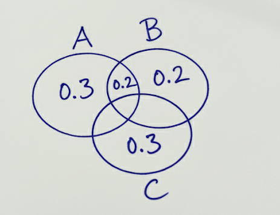

# Independence

> The property of **independence** is a highly abstract and precise technical concept that expresses the idea that the occurrence (or non-occurrence) of one event provides no information about the occurrence of another. In experiments with more than two events, if a pair of events $A$ and $B$ is independent, then the probability of their intersection (overlap) equals the product of the probabilities of the individual events:  $P(A \cap B) = P(A) \cdot P(B)$.
> 

> The word **independence** can evoke the semantics of being *separate* or *non-overlapping*, but in probability theory it refers to a more subtle notion: that knowing whether one event occurred does not change the probability of the other. Independence does not necessarily mean that the events are disjoint — in fact, disjoint events (with positive probability) are always dependent, since the occurrence of one implies the non-occurrence of the other.
> 

> **Note:** In technical fields, we need to give precise names to our notions. Often, words from a common language are reused, but in a sense, a technical language becomes its own distinct language.
> 

> Note: A better name for this concept would be non-informativeness.
> 

A and B, are independent.

## Formulation

> Two events $A$  and $B$ are independent if the occurrence of one does not affect the probability  of the other.
> 
- Two events are independent if:  $P(A \mid B) = P(A) \quad\text{and}\quad P(B \mid A) = P(B)$
- Which implies,  $P(A \cap B) = P(A) \cdot P(B)$.

## Mutual Exclusivity

> **Mutual Exclusivity** refers to a property of two events where they **cannot occur at the same time**.
> 

> Mutual exclusivity implies **complete negative dependence**, unlike independence.
> 
- $A$ and $B$ are $\textbf{mutually exclusive}$ (disjoint) if $A \cap B = \emptyset$.
- Then:  $P(A \cap B) = 0$
- Note: mutually exclusive events **cannot be independent** unless one has probability 0.

## Intuition

> How to **think about** independence?
> 

### No “influence” idea

> Think of independence as **one event not telling you anything about the other**.
> 

> Flipping two coins, $X$ = first coin is heads, $Y$ = second coin is heads. Knowing the first coin is heads **doesn’t change** the probability that the second coin is heads.
> 

### Another intuitive way: “fraction of the world”

> Imagine the universe of possibilities as a pie.
> 
- $P(X)$ = fraction of pie where $X$ occurs.
- $P(Y)$ = fraction of pie where $Y$ occurs.
- If $X$ and $Y$ are independent, the fraction of pie where **both** happen is just the product of the two fractions.

## Relation

> Which are the other alternatives to formulation of the idea of independence between events?
> 
- Information-Theoretic Formulation
- Causal Formulation

## Case

> Let reason about a case for two possible events of an experiment - and demonstrate that they can be independent.
> 

Let say that we have,  that we have  events A, and B in which:

1. $P(A \cup B)$ $= P(A) + P(B) - P(A \cap B)$ $= 1$
2. $P(A \cap B) = P(A) P(B)$
3. $P(A) < 1$
4. $P(B) < 1$

Find a pair of probabilities for A, and B that satisfy the constraints.

## QA

### What is the semantic of the word **Independence** in the context of Probability?

- In normal language, “independent” often implies **completely separate things**, or “no overlap.”
- In probability, events **can overlap** (both occur at the same time) and still be independent if their probabilities satisfy the multiplication rule.
- In Statistics: It measures the **level of statistical non-influence.**

### What is the relation of **Mutual Exclusivity** and **Independence**?

- Mutually exclusive → knowing one happens means the other cannot happen (strong negative dependence).
- Independent → knowing one happens tells you nothing about the other (no dependence).

### How to think about probability independence?

- **Elementary view (two-step):** "Doing one, then the other, doesn’t change anything."
- **Distribution view:** Joint law splits into marginals, $P(A \cap B) = P(A)P(B)$.
- **σ-algebra view:** Information from one σ-algebra doesn’t affect probabilities in the other.
- **Information theory view:** Mutual information $I(X;Y)=0$.

### What is the relationship between independence and correlation?

> **Independence ⇒ Zero Correlation** (but not vice versa).
> 

## References

- https://en.wikipedia.org/wiki/Independence_(probability_theory)
