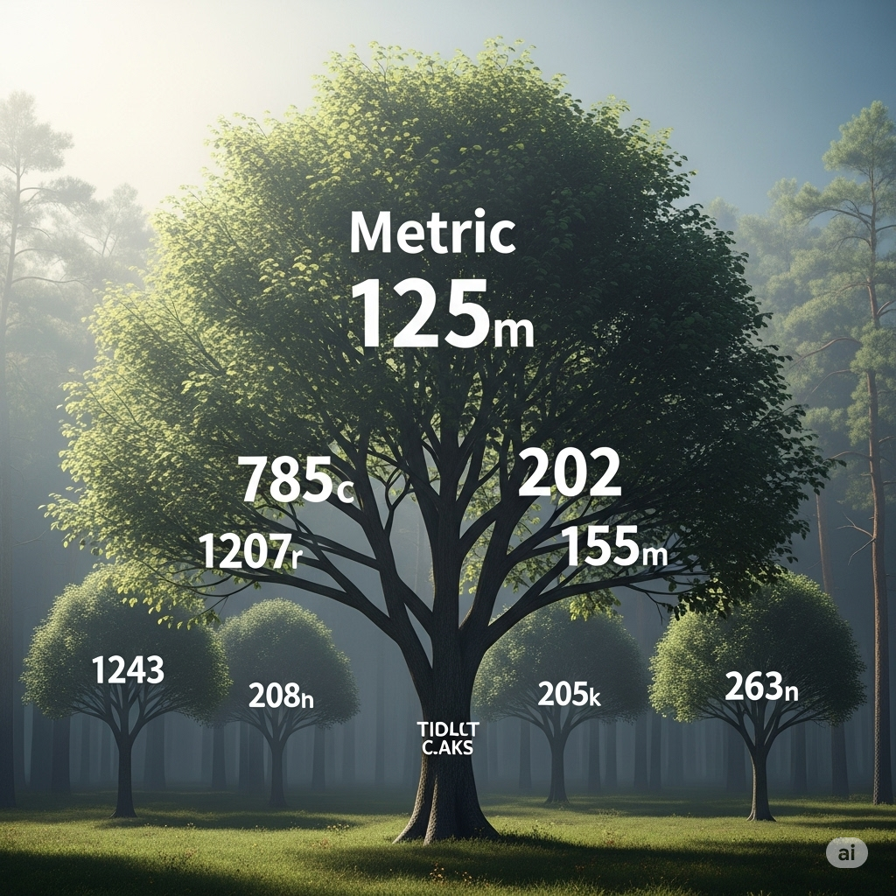
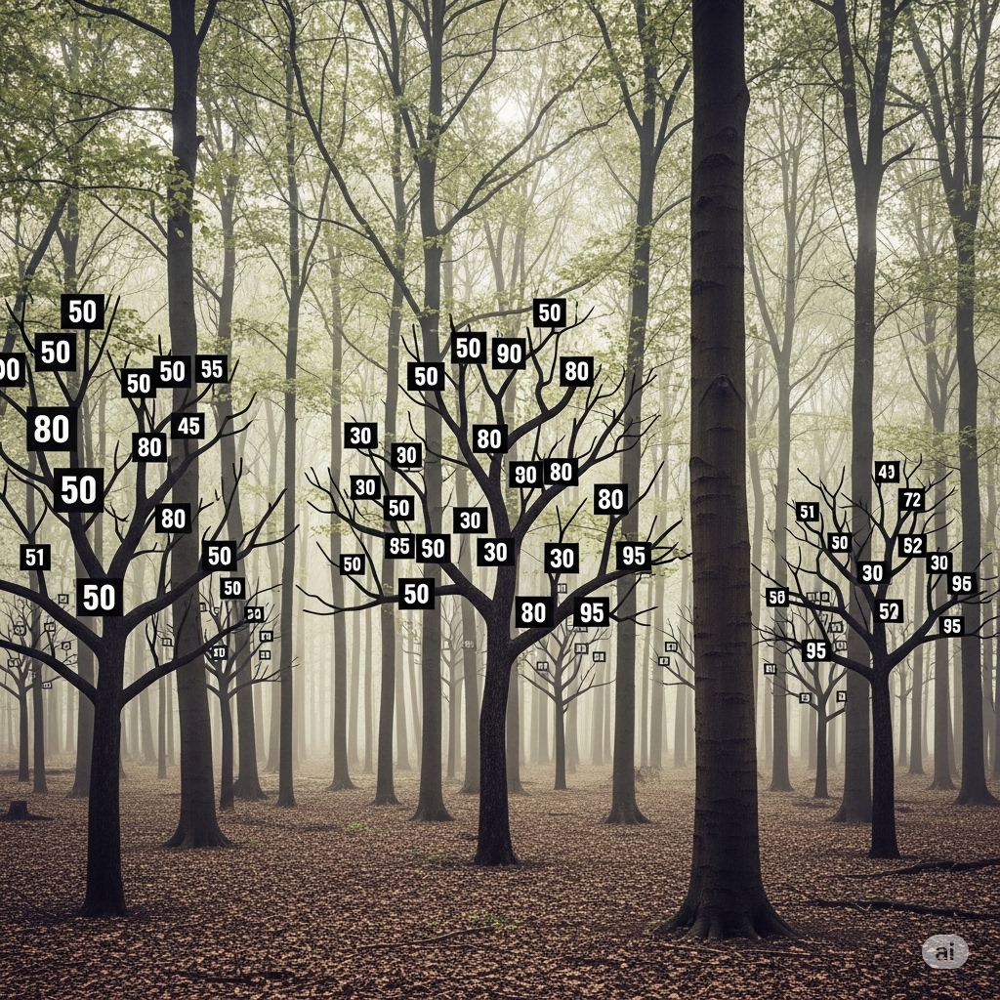

# Trade-Off

 : Multiple-Criteria Decision-Making (MCDM) (Multiple-Criteria%20Decision-Making%20(MCDM)%20222c0f5171ec801f912effc86df5a7b1.md)

> This **note offers a deep examination** of how decisions can be assessed and compared through the lens of diverse evaluation metrics.
> 

> **Trade-offs** refer to the compromises or sacrifices that must be made when choosing between two or more options. They involve giving up some benefits or advantages of one option to gain benefits or advantages of another option. **Trade-offs** can occur in various contexts, including personal decision-making, business strategy, and public policy.
> 

Dominant Solution.

Partial Dominant Solution.

## 🔁 **Analogy of Decision Quality**

### 🟦 **Dominant Option** *(Opción Dominante / Opción Superior)*

> **Una opción que brilla sin sombra.**
> 
> 
> Es claramente mejor en todas las métricas relevantes. No hay pérdida, ni ambigüedad: simplemente es la mejor.
> 

### 🟧 **Compensated Option** *(Opción Parcial / Opción Mixta)*

> **Una opción que brilla con sombras.**
> 
> 
> Una opción matizada por sombras.
> 
> **Una verdad parcial, pero suficiente.**
> 
> No domina por completo, pero ofrece un equilibrio valioso entre ventajas y sacrificios. Es una solución con matices, fruto del compromiso y la ponderación.
> 

## Formalization

> A **trade-off exists when no dominant option can be chosen without sacrificing some metric**.
> 

> Decision-making requires balancing which metric improvements are worth the sacrifices on others.
> 

Given:

- A **decision** $D$ composed of **options**: $D = \{ o_1, o_2, \ldots, o_n \}$  where each $o_i$ is an option or choice element.
- A set of **metrics**:  $M = \{ m_1, m_2, \ldots, m_k \}$  where each metric $m_j: D \to \mathbb{R}$ measures some attribute or quality of the decision $D$.

Dominance in Options:

- In other words, $o_a$ is at least as good as $o_b$ on all metrics and strictly better on at least one.
- We say option $o_a$ **dominates** option $o_b$ **with respect to metric $m_j$** if:  $m_j(o_a) \geq m_j(o_b) \quad \text{and} \quad m_j(o_a) > m_j(o_b) \quad$for at least one metric.

There is a Trade-Off when:

- **No single option dominates all others on all metrics**.
- Choosing option $o_a$ improves some metrics but worsens others relative to $o_b$.

## Visualization

> **Note:** Another way to visualize this is using a tree structure, where each branch represents a metric, each tree represents an option, and the entire forest represents the set of options.
> 

> Represent decision and metrics as a matrix:
> 

| Option | $m_1$ | $m_2$ | $\dots$ | $m_k$ |
| --- | --- | --- | --- | --- |
| $o_1$ | val | val | ... | val |
| $o_2$ | val | val | ... | val |
| $\vdots$ | $\vdots$ | \vdots | $\vdots$ | $\vdots$ |
| $o_n$ | val | val | ... | val |

## Case Studies

- **Product Selection with Conflicting Metrics:** A company must choose between product designs that differ in cost and quality. No single product is best in both metrics, illustrating a trade-off where improving one aspect means sacrificing another.
- **Employee Candidate Evaluation:**  An HR team evaluates candidates based on experience and cultural fit. Each candidate excels in one metric but not the other, so no candidate dominates, requiring a balanced decision considering both factors.
- **Environmental Policy Decisions:** A government compares policies on CO2 reduction and economic cost. Some policies dominate others, while others require weighing the trade-offs between environmental benefits and financial impact.

## References

- https://en.wikipedia.org/wiki/Trade-off
- https://en.wikipedia.org/wiki/Pareto_efficiency
- https://en.wikipedia.org/wiki/Multi-objective_optimization
